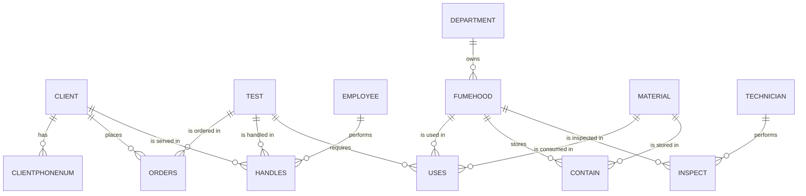

# Laboratory Database Design (MySQL)

A relational database for a drug-testing laboratory that tracks clients, test orders, employees, materials, fume hoods, and inspections, built so the lab can **trace every test back to the materials and equipment it used** for quality and contamination investigations.

**Tools:** MySQL, SQL (DDL and DML), draw.io (ER modeling)
**Course:** MSBX 5405, University of Colorado Boulder
**Team:** Ryan Bennett, Chirag Chirag, Christina Kuleshevich, Anusuya Roysarkar, Emily Tellschow

---

## Business Requirements
The lab needed one system to:
- Store **clients** (company, contact, phone, address) and the **tests** they order
- Record which **employee** handled each test and when
- Track **materials** in stock by lot number and expiration date
- Record which **fume hoods** and materials each test used, in case of contamination
- Log **fume hood inspections** (date, pass/fail, outside technician) and the **department** each hood belongs to

## Data Model
13 normalized tables with primary and foreign keys. Many-to-many relationships are resolved with junction tables (`ORDERS`, `HANDLES`, `USES`, `CONTAIN`, `INSPECT`), and multi-valued phone numbers live in `CLIENTPHONENUM`.



The original ER diagram (Chen notation) is in `er_diagram.drawio`. Open it free at [app.diagrams.net](https://app.diagrams.net).

## Business Questions Answered (`queries.sql`)
| # | Question | Finding on sample data |
|---|---|---|
| 1 | How many tests has each employee handled? | One employee handled 6 of 19 tests, a workload concentration risk |
| 2 | Which clients order the most tests? | Edgetag and Twitternation lead with 4 tests each |
| 3 | **Which tests and clients were exposed to a fume hood that failed inspection?** | Hood H3 failed; the query lists every affected test and client for follow-up |
| 4 | Which materials expire within 12 months? | Flags lots already expired or expiring soon |
| 5 | Which materials, hoods, and departments does each test use? | Full "recipe" per test for audits |
| 6 | How heavily is each fume hood used? | Utilization by department for capacity planning |
| 7 | Which test orders have no employee assigned? | Surfaces one unassigned order |
| 8 | Headcount and average salary by hire year | Workforce summary for management |

## Files
| File | Description |
|---|---|
| `schema.sql` | Creates the database, all 13 tables with keys, and sample data |
| `queries.sql` | 8 business queries using joins, aggregation, and date logic |
| `er_diagram.drawio` | Original ER diagram |
| `Project_Proposal.pdf` | Requirements and design proposal |

## How to Run
```sql
-- In MySQL Workbench or the mysql CLI (MySQL 8+)
SOURCE schema.sql;
SOURCE queries.sql;
```
